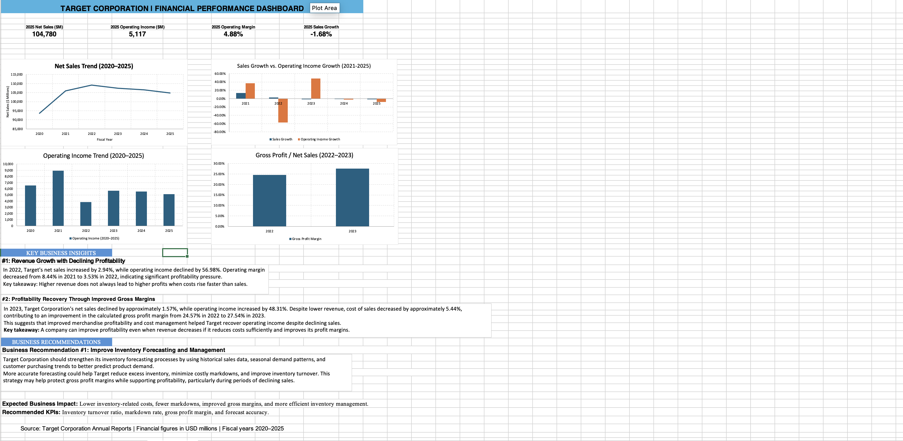

# Target Corporation | Financial Performance Analysis (2020–2025)

## Project Overview

This project analyzes Target Corporation's financial performance from 2020 to 2025 using Microsoft Excel. The objective is to evaluate revenue trends, profitability, and operating performance while developing data-driven business recommendations.

The project demonstrates my ability to analyze financial statements, calculate key performance indicators (KPIs), create dashboards, and communicate actionable business insights.

## Financial Dashboard

## Tools & Skills

- Microsoft Excel
- Financial Statement Analysis
- Data Cleaning and Organization
- Year-over-Year Growth Calculations
- Financial KPI Development
- Gross Profit and Operating Margin Analysis
- Data Visualization and Dashboard Design
- Business Insights and Recommendations

## Key Performance Indicators

The dashboard tracks:

- Net Sales
- Operating Income
- Net Earnings
- Sales Growth Rate
- Operating Income Growth Rate
- Operating Profit Margin
- Gross Profit Margin (2022–2023)

## Key Business Findings

### 1. Revenue Growth With Declining Profitability (2022)

In 2022, Target Corporation's net sales increased by approximately **2.94%**, while operating income declined by **56.98%**.

Operating margin decreased from **8.44% in 2021 to 3.53% in 2022**, indicating significant profitability pressure.

**Business Insight:** Revenue growth does not necessarily lead to higher profitability when operating costs and merchandise expenses increase.

### 2. Profitability Recovery Through Improved Gross Margins (2023)

In 2023, Target's net sales decreased by approximately **1.57%**, while operating income increased by **48.31%**.

Cost of sales declined by approximately **5.44%**, contributing to an increase in calculated gross profit margin from **24.57% in 2022 to 27.54% in 2023**.

**Business Insight:** Improved merchandise profitability and cost management can help a company recover operating income even when revenue declines.

### 3. Recent Financial Performance (2025)

Target reported the following financial results for fiscal 2025:

- **Net Sales:** $104.78 billion
- **Operating Income:** $5.12 billion
- **Operating Margin:** 4.88%
- **Sales Growth:** -1.68%

**Business Insight:** Target's declining sales and operating margins highlight the importance of monitoring revenue performance, cost efficiency, and profitability.

## Business Recommendations

### Recommendation 1: Improve Inventory Forecasting and Management

Target should strengthen inventory forecasting by analyzing historical sales, seasonal demand patterns, and customer purchasing trends.

Improved forecasting could help reduce excess inventory, minimize costly markdowns, and improve inventory turnover.

**Expected Business Impact:**
- Lower inventory-related costs
- Fewer merchandise markdowns
- Improved gross profit margins
- More efficient inventory management

**Recommended KPIs:**
- Inventory Turnover Ratio
- Markdown Rate
- Gross Profit Margin
- Forecast Accuracy

## Project Methodology

1. Collected financial information from Target Corporation's annual financial reports.
2. Organized historical financial data in Microsoft Excel.
3. Calculated sales growth, operating income growth, and profitability ratios.
4. Created financial visualizations to identify performance trends.
5. Compared revenue growth with operating profitability.
6. Analyzed cost of sales and gross profit margin changes.
7. Developed business insights and recommendations based on financial trends.

## Project Files

- **Target_Financial_Performance_Analysis1.xlsx** — Financial dataset, calculations, and interactive Excel workbook.
- **dashboard.png** — Screenshot of the financial performance dashboard.

## Data Source

Target Corporation Annual Reports and Financial Highlights.

Financial figures are presented in USD millions unless otherwise noted. Gross margin comparisons use the cost-of-sales figures documented in the workbook.

## Project Purpose

This independent portfolio project demonstrates my analytical, financial modeling, and data visualization skills.

As an Information Systems and Analytics student, I developed this project to apply financial analysis and business intelligence concepts to real-world business performance.

The project reflects skills relevant to **Data Analyst, Business Analyst, and Business Intelligence Analyst** internship opportunities.
Financial Calculations & Methodology

This project uses financial data from Target Corporation's annual reports to evaluate revenue growth, operating performance, and profitability.

1. Year-over-Year Sales Growth

Formula:

Sales Growth (%) = (Current Year Net Sales − Previous Year Net Sales) / Previous Year Net Sales × 100

Excel formula:
=(B3-B2)/B2

This metric measures how much Target's net sales increased or decreased compared with the previous year.

2. Operating Profit Margin

Formula:

Operating Margin (%) = Operating Income / Net Sales × 100

Excel formula:
=C2/B2

Operating margin measures how much operating profit Target generates for every dollar of net sales.

3. Operating Income Growth

Formula:

Operating Income Growth (%) = (Current Year Operating Income − Previous Year Operating Income) / Previous Year Operating Income × 100

Excel formula:
=(C3-C2)/C2

This metric evaluates changes in Target's operating profitability from one year to the next.

4. Gross Profit

Formula:

Gross Profit = Net Sales − Cost of Sales

This calculation measures the amount remaining after deducting the direct cost of merchandise sold.

5. Gross Profit Margin

Formula:

Gross Profit Margin (%) = Gross Profit / Net Sales × 100

This metric evaluates merchandise profitability before operating expenses.

6. Cost of Sales Growth

Formula:

Cost of Sales Growth (%) = (Current Year Cost of Sales − Previous Year Cost of Sales) / Previous Year Cost of Sales × 100

This calculation helps explain whether changes in merchandise costs contributed to improving or declining gross margins.

Analytical Approach

Collected historical financial information from Target Corporation's annual reports.

Organized financial figures into structured Excel worksheets.

Calculated financial KPIs using Excel formulas.

Created charts comparing sales growth, operating income, and profitability.

Interpreted financial trends and identified potential business challenges.

Developed recommendations focused on inventory forecasting, cost management, and profitability improvement.

Note: Percentage calculations in Excel use decimal values formatted as percentages. Financial figures are reported in USD millions, and annual comparisons use Target's fiscal-year reporting periods.
